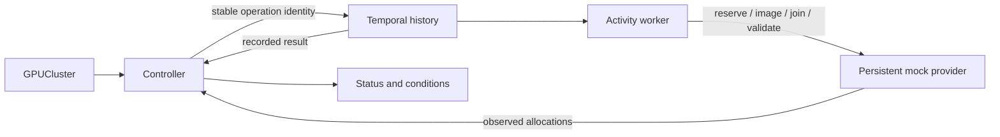

# Complete local control plane

This lab connects to real Kubernetes and Temporal servers. A separate persistent
HTTP provider simulates GPU hosts, imaging, joining, and validation. No physical
GPU nodes, drivers, cloud account, or hardware validation are involved.

## Inspect it

- [Kubernetes web workload](http://127.0.0.1:8088), served by a real Deployment/Pod.
- [Temporal UI](http://127.0.0.1:8233), default namespace, workflow IDs beginning `gpucluster/`.
- [Provider inventory](http://127.0.0.1:9080/v1/inventory), including jobs, counters, and audit events.

`GPUCluster/demo-gpu` requests three mock hosts with two concurrent host lifecycles.

```sh
cd lab
export PATH="/opt/homebrew/bin:/usr/local/bin:$HOME/go/bin:$PATH"
export DEVELOPER_DIR=/Library/Developer/CommandLineTools
make status
kubectl --kubeconfig ../.local/kubeconfig --context kind-infrastructure-tutorial \
  -n infrastructure-tutorial get gpuclusters -o yaml
```

## Start and verify

The tutorial machine already has Go, Python 3, kubectl, kind, Temporal CLI, and
the dedicated Podman VM. See [environment notes](../notes/ENVIRONMENT.md).

```sh
make test       # Go race tests, real envtest API tests, process-control tests
make up         # build and start/reuse the dedicated local services
make demo       # create the three-host sample
make live-test  # real-server recovery/failure checks; keeps the Ready demo
```

Kubernetes uses kind v1.37.0 on Podman, named `infrastructure-tutorial`, with a
dedicated `.local/kubeconfig` and explicit `kind-infrastructure-tutorial` context.
The web Deployment runs inside Kubernetes. Controller, worker, and provider are
host binaries, making their logs and restarts easy to inspect.

Temporal listens at 127.0.0.1:7233 with UI on 8233 and persistent development
database `.local/temporal/dev.db`. An already healthy local server is reused.
Provider state is separate, at `.local/provider/state.json`. One provider process
owns that file. Neither database belongs to the worker. All `.local` paths here
are relative to the repository root and ignored by Git.

## Ownership



The controller persists a finalizer and workflow-ID annotation before dispatch.
It never allocates hosts. The annotation survives status loss and Kubernetes
generation changes during deletion. The workflow alone sequences reservation
and bounded per-host `EnsureImage → JoinCluster → ValidateGPU`. Provider-owned
UID/slot and UID/operation keys protect side effects across retries/restarts.

On failure/cancellation the workflow cancels sibling work, waits for activity
acknowledgments/timeouts, and explicitly runs bounded disconnected cleanup.
On deletion the controller first fences/releases the provider UID, then cancels
and observes the original workflow, retaining the finalizer until termination.
Accepted image-job records remain as history; cleanup does not claim a physical
external operation was rolled back.

`Ready=True` means the simulated lifecycle completed and the allocation inventory
still matches. Spec is immutable. A new provisioning intent uses a new resource
and UID; terminal workflows are observed rather than automatically restarted.

## Live checks and evidence

`make live-test` records workflow/run IDs and outcomes in `.local/live/results.json`
and downloads actual histories alongside it. It exercises:

- Ready capacity on real servers and dropped allocation/image responses without duplicates.
- Total Kubernetes status loss recovering the same completed workflow run.
- Admission rejecting spec changes and unsupported GPU class producing terminal failure/compensation.
- Provider process restart and worker OS-process crash with original job recovery.
- Replay of actual history without activity registration or provider side effects.
- Deletion while imaging, closed-owner rejection, and stopped-worker finalizer retention.
- Actual Temporal activity cancellation acknowledgment preceding workflow compensation.
- Cleanup of this run's test resources while preserving the Ready demo.

If a check fails, partial test resources and logs remain for investigation.
`make up` resumes stopped host processes; inspect partial evidence before deleting
the failed run's resources through their normal finalizers.

The Go suite also replays a checked-in real-server history (worker identity
anonymized). Incompatible workflow command changes make this test fail. Existing
histories require compatible changes or [Temporal versioning](https://docs.temporal.io/develop/go/workflows/versioning).

## Controls

```sh
python3 scripts/lab.py restart worker --kill   # crash/restart this lab worker
python3 scripts/lab.py restart provider --kill # provider state survives
make down                                    # stop host processes and port-forward
make up                                      # resume against preserved state
bin/replay --history ../.local/live/<history-file>.json  # offline, no servers needed
```

`make down` preserves Temporal, kind, provider state, and history. Logs and tracked
PIDs live in `.local/runtime/`; the script verifies full commands before signaling
PIDs. `make up` restarts rebuilt binaries. Remove mock capacity by deleting its
GPUCluster and waiting for the finalizer. Inspect conditions, lastError, provider
health, logs, and workflow history if deletion waits.

## Teaching boundaries

Provider JSON state supports one writer, not a distributed database. Imaging uses
elapsed wall-clock time. Per-workflow/worker concurrency bounds do not establish
a global physical-hardware action limit. This design reports inventory drift;
automatic physical repair, adoption, resizing, physical-job cancellation, GPU
scheduling integration, and production deployment are explicit extensions.

Temporal duplicate-ID protection relies on retained history. A matching terminal
Kubernetes report will never trigger a restart after history expires. Erasing
history and all Kubernetes identity/status evidence together removes evidence of
workflow completion; provider operation records still guard side effects. A
deleting legacy object without recoverable identity retains its finalizer.

Sources: [kind with Podman](https://kind.sigs.k8s.io/docs/user/rootless/),
[Temporal development server](https://docs.temporal.io/cli/command-reference/server),
[replay](https://docs.temporal.io/workflow-execution#replays), and
[cancellation](https://docs.temporal.io/develop/go/activities/timeouts#activity-heartbeats).
